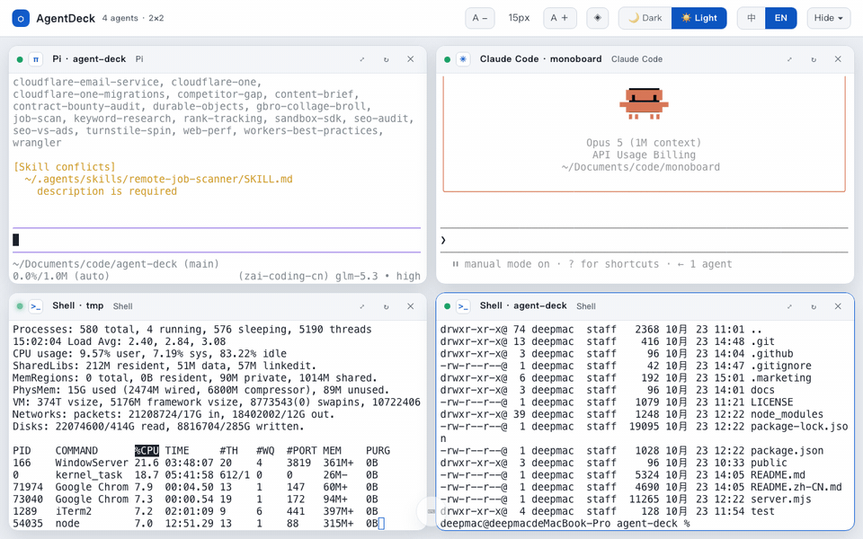
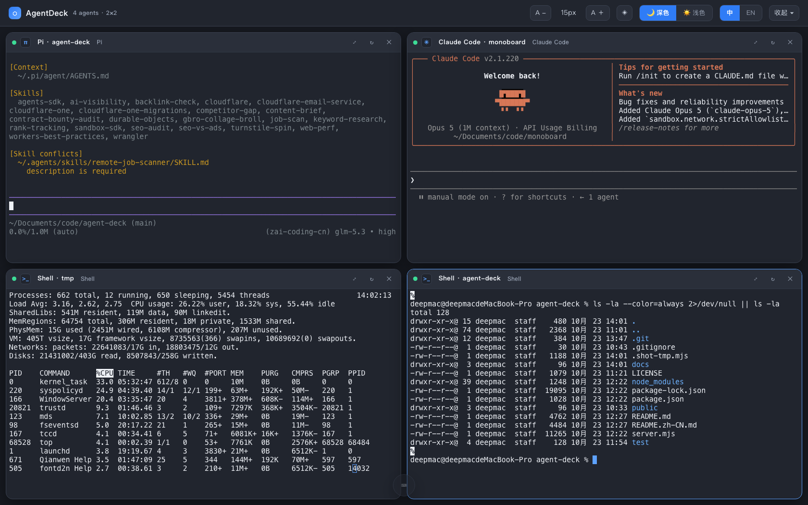
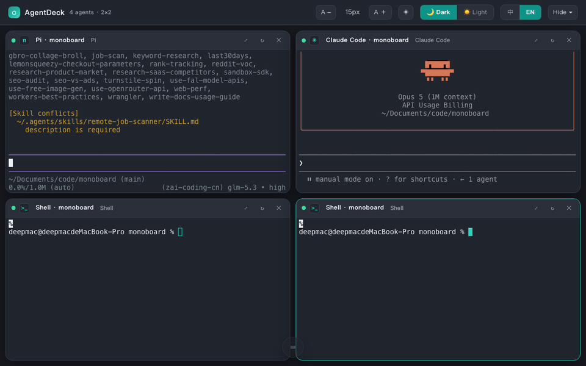

# AgentDeck

[English](README.md) | **[简体中文](README.zh-CN.md)**

[](https://github.com/flashclub/agent-deck/actions/workflows/ci.yml)
[](LICENSE)
[](https://nodejs.org)
[](#quick-start)
[](https://github.com/flashclub/agent-deck/pulls)
[](#quick-start)

**一屏四格，任选 AI 编程智能体。**

别再来回切终端标签了。AgentDeck 在浏览器里给你一个 2×2 的真终端矩阵——任意窗格启动 [pi](https://pi.dev)、[Claude Code](https://claude.com/product/claude-code)、[Codex](https://openai.com/codex)、Gemini CLI、Aider 或普通 shell，一页全览、统一指挥。

<p align="center">
  
</p>
<p align="center"><sub>从空白页面到四格智能体并行 —— 逐格点选启动，任意放大独占</sub></p>

<p align="center">
  
</p>
<p align="center"><sub>中文界面 · 四格并行 · 底部指挥条悬停展开</sub></p>

## 为什么做

并行跑多个编程智能体 = N 个终端窗口、N 个标签、无限 ⌘-Tab。AgentDeck 让所有智能体同屏可见，一个输入框既能单发也能群发，刷新页面进程也不丢。

## 快速开始

```bash
git clone https://github.com/flashclub/agent-deck.git
cd agent-deck
npm install
node server.mjs
# 打开 http://127.0.0.1:7788
```

要求：Node ≥ 22，macOS / Linux。无构建步骤、无配置文件。

智能体**自动探测**（`command -v`）：pi、Claude Code、Codex、Gemini CLI、Aider，外加登录 shell。想加别的，改 `server.mjs` 里的 `detectAgents()`。

## 功能

- **真终端** — node-pty + xterm.js，完整 ANSI / 256 色 / 全屏 TUI 渲染，智能体快捷键与本地完全一致
- **刷新/断线不死** — 窗格是服务端 PTY，每格 ~160KB 输出回放；关掉页面回来接着干
- **底部指挥条** — 悬停 ⌨ 图标展开：
  - `Tab` / `Shift+Tab` 循环切换目标（全部 → 格 1..4，自动跳过已停止的格）
  - `Enter` 发送到选中格
  - `⌘/Ctrl+Enter` 一键**广播全部**运行中的智能体
  - 收到的窗格紫色光晕闪烁；`Esc` 收起并把焦点还给终端
- **中英双语界面** — 默认英文，顶栏一键切换 中/EN，全部文案已国际化
- **窗格标题可编辑** — 点击标题重命名，悬停滑出完整路径；标题与格位刷新后保持不变
- **顶栏可收起** — 隐藏顶栏榨干屏幕空间，右上角 ⌃ 小按钮随时唤回
- **明暗双主题 + 六色强调色** — 深色非死黑、浅色高对比，终端光标跟随强调色；字号 12–24px 可调
- **窗格级控制** — 点击聚焦、`⤢` 放大独占、`↻` 重启、`✕` 关闭；输出流动时状态灯闪烁
- **智能目录选择** — 可选读取 pi 本地会话库提供最近项目目录（见隐私说明）
- **自绘对话框与 toast** — 全程无原生 `alert()`

<p align="center"></p>
<p align="center"><sub>指挥条实录 —— 一条消息，四格齐动</sub></p>

## 快捷键

| 键 | 作用 |
|---|---|
| `Tab`（指挥条内） | 切换发送目标 |
| `⌘/Ctrl+Enter` | 广播全部窗格 |
| `Alt+1..4` | 聚焦第 1–4 格 |
| `Esc` | 收起指挥条 / 取消对话框 |

其余按键（`Shift+Enter`、插话、中止等）由各智能体自己的 TUI 处理。

## 工作原理

```
浏览器（xterm.js ×4、指挥条、主题、i18n）
   │  WebSocket（JSON: spawn / input / resize / replay）
   ▼
Node 服务（server.mjs）
   │  node-pty  ── 每格一个 PTY
   ▼
pi / claude / codex / $SHELL  — 各自 cwd 里的完整 TUI
```

- 静态资源直接从 `node_modules` 提供（xterm.js），无打包器
- 每格维护环形缓冲，重连时回放最近输出
- 广播 = 向每个运行中的 PTY 写入 `文本 + \r`，智能体收到等同手打输入

## 隐私

- 数据不出本机：服务只绑定 `127.0.0.1`，无任何外发请求
- **仓库不含任何人的路径。**「最近目录」是运行时读取你本机 pi 会话库（`~/.pi/agent/sessions`）得到的——谁 clone 就看到谁自己的记录
- 不想要这个功能？`AG_RECENTS=0` 启动即可完全关闭扫描

## 安全

无鉴权（本地工具，刻意为之）。**不要**暴露到网络（`AG_HOST=0.0.0.0` 等于给局域网所有人发 shell）。

## 测试

```bash
node server.mjs &        # 先启动服务
npm run test:e2e         # 协议级端到端：shell 回显往返 + pi TUI 启动
```

## 许可证

[MIT](LICENSE)
